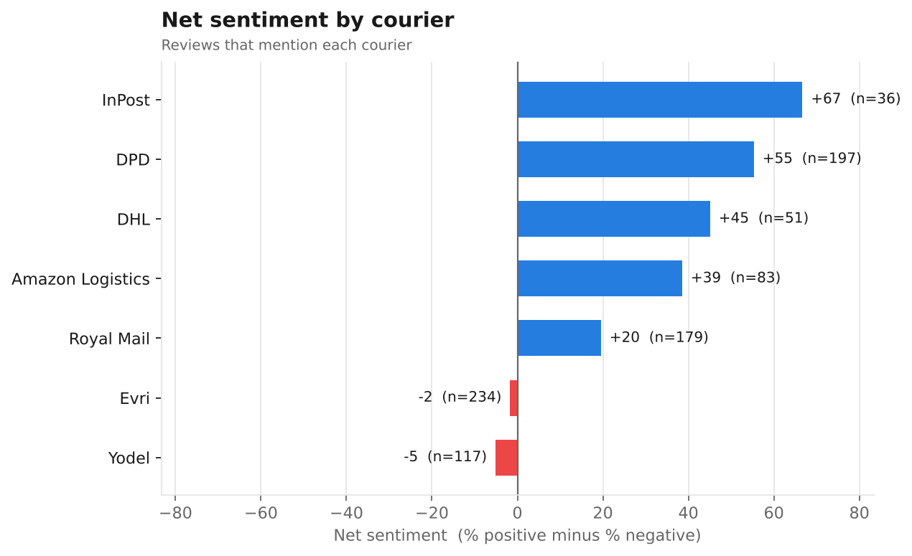
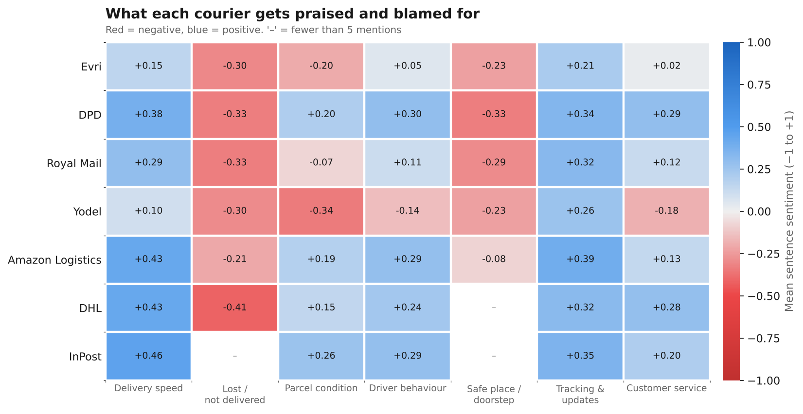
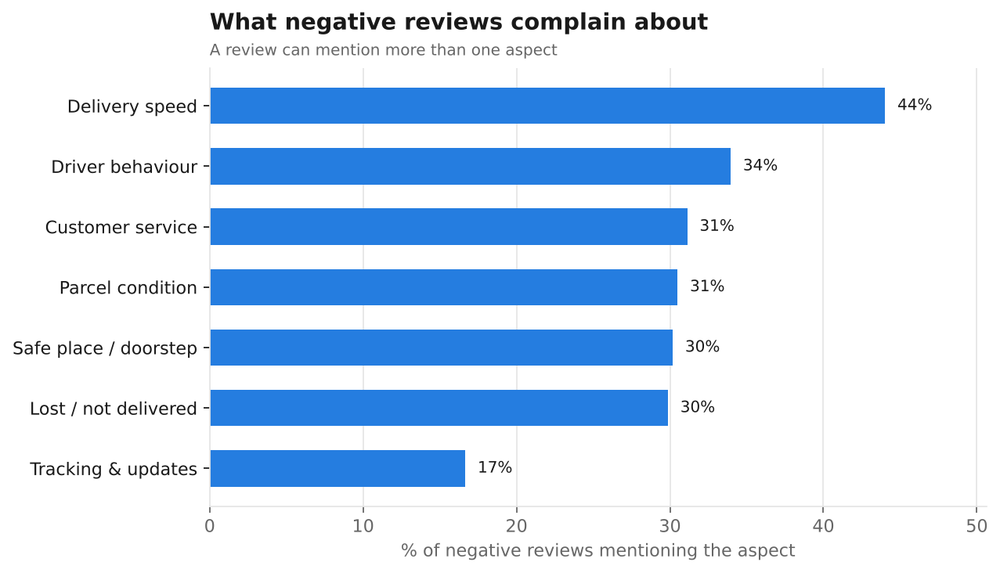
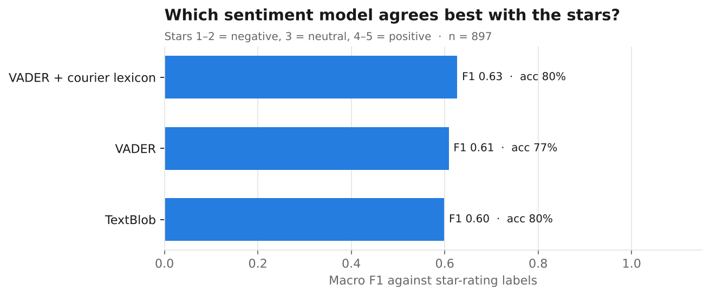

# Shipment Analysis: what UK shoppers really say about their couriers


Everyone has a courier horror story. This project turns thousands of UK Trustpilot reviews into
evidence: which couriers people complain about most, **what exactly** they complain about
(late, lost, damaged, dumped on the doorstep, impossible to contact), and which sentiment models
read these reviews most accurately.

It covers Evri (and Hermes), DPD, Royal Mail, Yodel, Amazon Logistics, DHL, Parcelforce, InPost,
UPS and FedEx.

> **Note on the charts below:** they come from a small **synthetic** demo file
> (`data/sample/demo_reviews_synthetic.csv`) so the repo runs out of the box. The numbers are made up.
> Real findings come from running the pipeline on the Kaggle data (see *Quick start*).

## What it does

| Step | How |
|---|---|
| Load | Reads CSV, Excel, JSON or Parquet and auto-maps column names (`Review` → `text`, `Stars` → `rating`) |
| Clean | Keeps two versions of each review: light-cleaned for sentiment models, fully normalised for topics |
| Courier tagging | Regex rules find which couriers a review mentions (handles "Hermes" → Evri, ignores "ups and downs") |
| Sentiment | VADER, VADER + a custom courier lexicon, TextBlob, and optionally RoBERTa (transformer) |
| Aspect sentiment | Splits reviews into sentences and scores 8 aspects separately: speed, lost parcels, condition, driver, doorstep, tracking, customer service, price |
| Themes | TF-IDF + NMF topic modelling on complaints and praise separately (BERTopic optional) |
| Evaluation | Compares every model against the reviewer's own star rating (accuracy, macro F1, confusion matrix) |
| Outputs | Clean CSVs, six charts, a `summary.md`, and an interactive Streamlit dashboard |

## Charts (demo data)

| | |
|---|---|
|  |  |
|  |  |

## Quick start

```bash
git clone https://github.com/Sherryyy00/Shipment-Analysis.git
cd Shipment-Analysis
python -m venv .venv && source .venv/bin/activate      # Windows: .venv\Scripts\activate
pip install -r requirements.txt

# 1. Try it on the demo data
python -m shipment_analysis.pipeline --input data/sample/demo_reviews_synthetic.csv --out reports/demo --min-cell-n 5
streamlit run app/streamlit_app.py
```

### Running it on real reviews

1. Download **[Trustpilot Reviews 123k](https://www.kaggle.com/datasets/jerassy/trustpilot-reviews-123k)**
   from Kaggle (UK reviews across 1,680 companies, many of which name the courier).
   With the Kaggle CLI: `kaggle datasets download jerassy/trustpilot-reviews-123k -p data/raw --unzip`
2. Run the pipeline. It keeps only reviews that mention a courier:
   ```bash
   python -m shipment_analysis.pipeline --input data/raw/trustpilot_reviews_2005.csv --out reports/full
   ```
   If a column isn't detected, name it: `--text-col "review text" --rating-col stars --date-col date`.
3. Open the dashboard (`streamlit run app/streamlit_app.py`) and pick `reports/full` in the sidebar.

Any other review file works the same way, for example a Trustpilot export of a single courier's page.

### Optional: transformer sentiment and BERTopic

```bash
pip install -r requirements-extra.txt
python -m shipment_analysis.pipeline --input data/raw/<file>.csv --out reports/full --transformer --bertopic
```
This uses [`cardiffnlp/twitter-roberta-base-sentiment-latest`](https://huggingface.co/cardiffnlp/twitter-roberta-base-sentiment-latest).
A GPU helps but isn't required. Use `--sample 5000` for a quicker first run.

## Project structure

```
├── src/shipment_analysis/
│   ├── io.py          # load + map columns
│   ├── clean.py       # text cleaning
│   ├── couriers.py    # courier detection
│   ├── sentiment.py   # VADER, courier lexicon, TextBlob, RoBERTa
│   ├── aspects.py     # aspect-based sentiment
│   ├── topics.py      # NMF / BERTopic themes
│   ├── evaluate.py    # model vs star-rating comparison
│   ├── plots.py       # static charts
│   └── pipeline.py    # CLI that runs everything
├── app/streamlit_app.py          # interactive dashboard
├── notebooks/01_walkthrough.ipynb # step-by-step explanation
├── scripts/make_demo_data.py     # builds the synthetic demo file
├── tests/                        # pytest (20 tests, runs in CI)
├── data/sample/                  # synthetic demo data
├── data/raw/                     # your downloaded data (git-ignored)
└── reports/<run>/                # processed CSVs, figures, summary.md
```

## Design choices worth knowing

* **Two cleaned texts, not one.** VADER reads "NEVER again!!!" as more negative than "never again", so the
  sentiment models get text with capitals and punctuation intact. Topic modelling gets lowercase words only.
* **A courier lexicon on top of VADER.** Stock VADER rates *"parcel lost and arrived damaged"* far too mildly
  because words like *lost*, *damaged* and *delayed* aren't emotional in general English. Adding 40 delivery
  terms is cheap and transparent, and the evaluation step shows whether it actually agrees better with the
  star ratings on your data.
* **Aspects at sentence level.** "Lovely driver but the box was crushed" is one positive and one negative
  aspect, not a lukewarm overall score.
* **Courier names removed before topic modelling**, so themes describe what happened instead of who.
* **Star ratings as a weak label.** They make model comparison possible without hand-labelling, but a 1★
  on a retailer's page may be about the shop, so treat the scores as agreement rather than true accuracy.

## Limitations and next steps

* Courier detection is keyword based. A review naming two couriers counts for both.
* Aspect keywords are hand-written. `aspect_sentences.csv` makes misses easy to spot and extend.
* Next ideas: hand-label 300 reviews for a proper test set, fine-tune a small transformer on courier
  reviews, and add a Power BI version of the dashboard.

## Version history

* **v2 (2026):** full rebuild. Real courier review data, modular pipeline, aspect sentiment, topic modelling,
  model evaluation, dashboard, tests and CI.
* **v1 (2021):** a notebook that scraped one ScienceDirect page. The site blocked the request, so the
  analysis ran on error and navigation pages instead of real content. It's kept in the git history only.

---
Built by Muhammad Sheryar Adil · MSc Data Science, Teesside University
